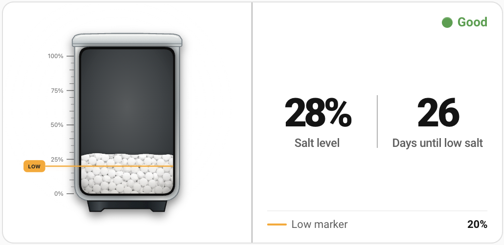
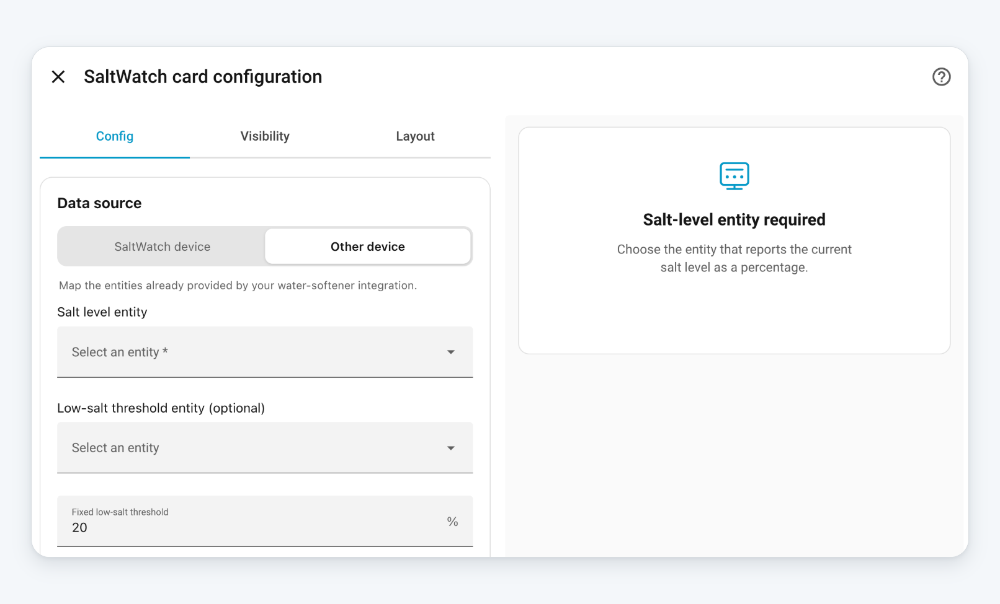

# SaltWatch Card

[](https://github.com/thomasgregg/saltwatch-card/releases/latest)
[](https://github.com/thomasgregg/saltwatch-card/actions/workflows/ci.yml)
[](https://my.home-assistant.io/redirect/marketplace_repository/?owner=thomasgregg&repository=saltwatch-card&category=plugin)
[](https://github.com/thomasgregg/saltwatch-card/blob/main/LICENSE)

### See your water-softener salt level at a glance

SaltWatch Card is the visual Home Assistant companion for
[SaltWatch](https://github.com/thomasgregg/saltwatch). It turns SaltWatch's
estimated salt-level sensor into a detailed tank that is easy to understand
from across the room—no interpreting raw percentages. It can also show
SaltWatch's refill forecast, so you know how much salt remains and when the low
threshold is likely to be reached.



SaltWatch Card is optimized for devices running the official SaltWatch
firmware, with automatic and rename-safe entity discovery. Other water
softener integrations can use the same card by mapping their existing Home
Assistant entities in the graphical editor.

## Contents

- [Why use it?](#why-use-it)
- [Made for SaltWatch](#made-for-saltwatch)
- [Other water softeners](#other-water-softeners)
- [What the states mean](#what-the-states-mean)
- [Installation](#installation)
  - [Marketplace](#marketplace)
  - [HACS](#hacs)
  - [Manual installation](#manual-installation)
- [Graphical editor](#graphical-editor)
  - [Web interface shortcut](#web-interface-shortcut)
    - [Open remotely with Chromium Link](#open-remotely-with-chromium-link)
  - [Dashboard sizing](#dashboard-sizing)
- [Card options](#card-options)
- [Home Assistant friendly by design](#home-assistant-friendly-by-design)
- [Languages](#languages)

## Why use it?

- **Understand the level instantly.** The salt surface moves with the sensor,
  while the ruler and large percentage make the reading easy to scan.
- **Know when to refill.** A clear orange LOW marker shows the threshold you
  chose in SaltWatch.
- **Look ahead.** Optionally show SaltWatch's estimated days until low salt by
  itself or beside the current level.
- **Understand forecast learning.** When no estimate is ready, the card shows a
  concise reason or progress such as `4 of 7 days collected`.
- **Spot problems quickly.** Good, low-salt, calibration, and sensor-fault
  states have clear labels and familiar Home Assistant colors.
- **Open the device from your dashboard.** Enable an optional shortcut to the
  device's web interface, with Chromium Link support for remote access.
- **Looks at home in Home Assistant.** The card follows the active light, dark,
  or custom theme and uses native Home Assistant card styling.
- **Fits your dashboard.** It adapts from a wide two-column card to a clean
  mobile layout without losing the tank visualization.
- **Feels like the real tank.** The molded container, granular salt texture,
  uneven surface, scale, and subtle material lighting make the reading more
  tangible than a standard gauge.

## Made for SaltWatch

[SaltWatch](https://github.com/thomasgregg/saltwatch) monitors the salt level in
a water softener and exposes the result to Home Assistant. This card presents
the most important SaltWatch information as one focused visual:

- the estimated salt level;
- the estimated days until the low-salt threshold;
- the configured low-salt threshold;
- the current SaltWatch health status.

The graphical editor stores the selected Home Assistant device rather than a
collection of rename-prone entity IDs:

```yaml
type: custom:saltwatch-card
device_id: 01JEXAMPLEHOMEASSISTANTDEVICEID
```

Select the SaltWatch device in the graphical editor; there is normally no need
to find or type the device ID. The card resolves the level, health, threshold,
forecast, and forecast-detail entities from that device at runtime. User-renamed
entity IDs therefore continue to work, and entities from different SaltWatch
devices cannot be combined accidentally.

Use the latest official SaltWatch firmware. The selected device must provide
all six card entities: **Salt Level**, **Salt Status**, **Low Salt Threshold**,
**Estimated Days Until Low Salt**, **Forecast Status**, and **Forecast
Details**. The editor reports missing, duplicate, or disabled entries instead
of silently substituting another entity.

## Other water softeners

Choose **Other device** under **Data source** to use the card with another
Home Assistant water-softener integration. Select the entity that reports the
current salt level as a number from 0 to 100. That is the only required
mapping; the card can derive a Good or Low salt status from the level and a
fixed threshold.

You can optionally map:

- a low-salt threshold entity;
- a status entity;
- an estimated days-until-low entity;
- SaltWatch-style forecast status and detail entities for learning or
  unavailable explanations.

For example:

```yaml
type: custom:saltwatch-card
source: entities
level_entity: sensor.greenline_40_salt_level
threshold_entity: number.greenline_40_low_salt_threshold
status_entity: sensor.greenline_40_status
forecast_entity: sensor.greenline_40_days_until_low
```

When `threshold_entity` is omitted, `low_threshold` sets the marker and status
boundary and defaults to `20`. When `forecast_entity` is omitted, forecast
display choices are hidden and the card shows the current level. Tapping the
card opens the mapped salt-level entity by default.

## What the states mean

| State | What you see | What it tells you |
| --- | --- | --- |
| **Initializing** | Neutral hourglass and a striped `?` tank | SaltWatch is waiting for its first trustworthy level. |
| **Good** | Green status | The reading is available and above the low threshold. |
| **Low salt** | Orange warning | The estimated level has reached the refill threshold. |
| **Calibration required** | Orange calibration symbol | SaltWatch needs calibration before it can provide a trustworthy level. |
| **Sensor fault** | Red fault symbol | SaltWatch cannot currently provide a valid reading. |
| **No current reading** | Neutral question-mark symbol and a striped `?` tank | No trustworthy level is currently available, but SaltWatch has not reported a sensor fault. |

When the level is unavailable, the card never leaves an old percentage on
screen as though it were current. The tank switches to an explicit no-reading
state instead.

## Installation

### Marketplace

On Home Assistant 2026.11 and later, open **Settings → Marketplace** and
search for **SaltWatch Card**. Install it, reload your dashboard, and add
**SaltWatch Card** from the card picker. Home Assistant migrates existing HACS
installs to the Marketplace. [Home Assistant Marketplace guide](https://www.home-assistant.io/integrations/marketplace/)

### HACS

On Home Assistant 2026.10 and earlier, search the HACS default catalog for
**SaltWatch Card** and download it. Reload your dashboard and add
**SaltWatch Card** from the card picker. Use HACS to update the card on these
versions.

### Manual installation

1. Download `saltwatch-card.js` from the
   [latest release](https://github.com/thomasgregg/saltwatch-card/releases/latest).
2. Create the directory if needed, then copy the file to
   `/config/www/saltwatch-card/saltwatch-card.js` in Home Assistant. If this is
   the first time you have created `/config/www/`, restart Home Assistant.
3. Open **Settings → Dashboards**, select the three-dot menu, and open
   **Resources**.
4. Add `/local/saltwatch-card/saltwatch-card.js` as a **JavaScript module**.
5. Reload the browser, then add **SaltWatch Card** from the dashboard card
   picker.

The `/config/www/` directory is exposed under the `/local/` URL path. When
updating a manual install, replace the JavaScript file and update the existing
resource URL with a version query such as `?v=0.6.4` so clients load the new build.

## Graphical editor

The visual editor starts with a **Data source** choice. Keep **SaltWatch
device** for automatic discovery, or select **Other device** to map the
entities supplied by another integration. The live preview and the rest of the
layout controls work the same for both paths.

For SaltWatch devices, the card follows the Home Assistant device relationship
instead of relying on entity names. If required firmware entities are missing
or disabled, the editor lists them explicitly instead of guessing or pairing
another device. For another device, the salt-level entity is required while
threshold, status, and forecast mappings are optional.



Choose the complete, tank-only, or details-only layout visually. In the
complete layout, you can place the tank or the details first. The editor also
lets you choose the displayed values and visible elements with native Home
Assistant controls. Device access has its own **Web interface** section.
Tap, hold, and double-tap behavior is configured under **Actions**.

### Web interface shortcut

The shortcut is off by default. To turn it on, edit the card and select
**Web interface → Enable shortcut**.

- With **SaltWatch device** as the data source, leave **Web interface URL**
  blank to use the selected device's address from Home Assistant.
- Enter a full `http://` or `https://` address to override the detected address,
  or when the card uses **Other device**. The shortcut appears when a valid
  address is available.

| Card layout | How to open the web interface |
| --- | --- |
| **Tank only** | Click or tap the tank. |
| **Details only** | Use the external-link icon at the top left of the details panel. |
| **Tank and details** | Click the tank or use the single icon in the details panel. |

The icon aligns with the status and shows a round hover highlight. Both
shortcut targets support keyboard navigation. Other areas of the card use
the configured tap, hold, and double-tap actions.

By default, the web interface opens in a new tab on the phone or computer
viewing the dashboard. That device needs to be able to reach the web address.

#### Open remotely with Chromium Link

Chromium Link opens SaltWatch in a Chromium app running on your Home Assistant
host. This works while you are away if you can reach your Home Assistant
dashboard and the host can reach the device.

1. Install and configure **Mincka Chromium 1.7.0 or later** on Home Assistant
   OS. The setup guide covers enabling remote debugging and leaving its host
   port unmapped. [Mincka Chromium app](https://github.com/Mincka/ha-addons/tree/main/chromium) · [Chromium app configuration](https://github.com/thomasgregg/chromium-link#1-configure-the-chromium-add-on)
2. Install **Chromium Link 0.2.0 or later**, then add it under **Settings →
   Devices & services**. Chromium Link requires Home Assistant OS 2026.11 or
   later and an administrator account. [Chromium Link installation](https://github.com/thomasgregg/chromium-link#installation)
3. As an administrator, edit **SaltWatch Card → Web interface** and choose
   **Open with → Chromium Link**. This choice appears when the integration has
   registered its launcher. If it becomes unavailable, the shortcut opens in
   the current browser until the launcher returns.

If Chromium cannot resolve a device's `.local` address, try the device's local
IP address in **Web interface URL**. You can test the address in the Chromium
app itself. [Chromium Link troubleshooting](https://github.com/thomasgregg/chromium-link#troubleshooting)

For YAML, add the following to your existing card configuration. Leave out
`web_interface_open_with` for direct browser access and `web_interface_url`
to use the selected SaltWatch device's address.

```yaml
show_web_interface: true
web_interface_open_with: chromium_link
web_interface_url: http://saltwatch-a1b2c3.local/
```

### Dashboard sizing

The card uses automatic height by default. In a Sections dashboard, Home
Assistant's Layout editor also prevents resizing the card below the smallest
readable size for the selected content:

| Selected content | Minimum grid size |
| --- | --- |
| Complete card (tank and details) | 6 columns × 4 rows |
| Tank only | 3 columns × 3 rows |
| Details with one value | 3 columns × 2 rows |
| Details with level and forecast | 6 columns × 2 rows |

These are Home Assistant grid cells, not pixels. Changing the card content or
displayed values updates the resizing limits automatically. The minimums keep
labels and values legible and prevent clipped or overlapping layouts.

## Card options

| Option | What it does | Default |
| --- | --- | --- |
| `source` | Uses automatic SaltWatch discovery (`device`) or individually mapped entities (`entities`). Existing configurations without this option remain compatible. | Inferred from `level_entity`; otherwise `device` |
| `device_id` | Selects the SaltWatch device for automatic discovery. All six entities are resolved from its Home Assistant registry relationship. | Required for `device` source |
| `level_entity` | Maps a numeric salt-level percentage from another integration. | Required for `entities` source |
| `threshold_entity` | Maps the low-salt threshold from another integration. | Optional |
| `low_threshold` | Sets a fixed low-salt threshold when no threshold entity is mapped. | `20` for `entities` source |
| `status_entity` | Maps a device status. Without it, the card derives Good or Low salt from the level and threshold. | Optional |
| `forecast_entity` | Maps a numeric estimate of days until low salt. Forecast controls are hidden when omitted. | Optional |
| `forecast_status_entity` | Maps a SaltWatch-style forecast status for unavailable-state explanations. | Optional |
| `forecast_details_entity` | Maps SaltWatch-style forecast learning progress or details. | Optional |
| `show_status` | Shows or hides the status label in the upper-right corner. | `true` |
| `show_low_marker` | Shows or hides the low-marker summary below the values. The marker on the tank remains visible. | `true` |
| `display_mode` | Shows the complete card (`both`), only the tank (`tank`), or only the values and status (`details`). | `both` |
| `metric_mode` | Shows the current level (`level`), refill forecast (`forecast`), or both values side by side (`both`). | `level` |
| `section_order` | Places the tank first (`tank-first`) or the details first (`details-first`) in the complete layout. | `tank-first` |
| `show_web_interface` | Enables the web interface shortcut in the selected layout. | `false` |
| `web_interface_open_with` | Opens the device in the current browser (`browser`) or through the registered Chromium Link launcher (`chromium_link`). Falls back to the current browser when the launcher is unavailable. | `browser` |
| `web_interface_url` | Sets the full address for the shortcut. An empty value uses the selected SaltWatch device’s address, when available. | Optional |
| `tap_action` | Chooses what happens when the card is tapped. | `more-info` |
| `hold_action` | Chooses what happens when the card is held. | `none` |
| `double_tap_action` | Chooses what happens when the card is double-tapped. | `none` |

### A simpler card

The tank can stand on its own when you want a more visual dashboard:

```yaml
type: custom:saltwatch-card
device_id: 01JEXAMPLEHOMEASSISTANTDEVICEID
display_mode: tank
```

Or keep the percentage while hiding secondary information:

```yaml
show_status: false
show_low_marker: false
display_mode: details
```

## Home Assistant friendly by design

SaltWatch Card uses Home Assistant's native success, warning, and error theme
colors. Low salt and calibration are orange warnings; red is reserved for an
actual sensor fault. The card also supports Home Assistant's graphical card
editor, keyboard interaction, configurable tap/hold actions, multiple languages,
and responsive Sections dashboards.

## Languages

SaltWatch Card currently supports **Danish, English, and German**. The card and its
graphical editor automatically follow the language selected in each Home
Assistant user profile and update immediately when that language changes.
Danish and German regional variants such as `da-DK`, `de-DE`, and `de-AT`
share their respective translations while keeping their regional number
formatting. Unsupported languages fall back safely to English.

The card deliberately stays focused on the tank level and refill timing. Pair
it with Home Assistant's native Tile and Statistics Graph cards when you also
want threshold controls, measurement history, or distance details.

## License

[MIT](LICENSE)
