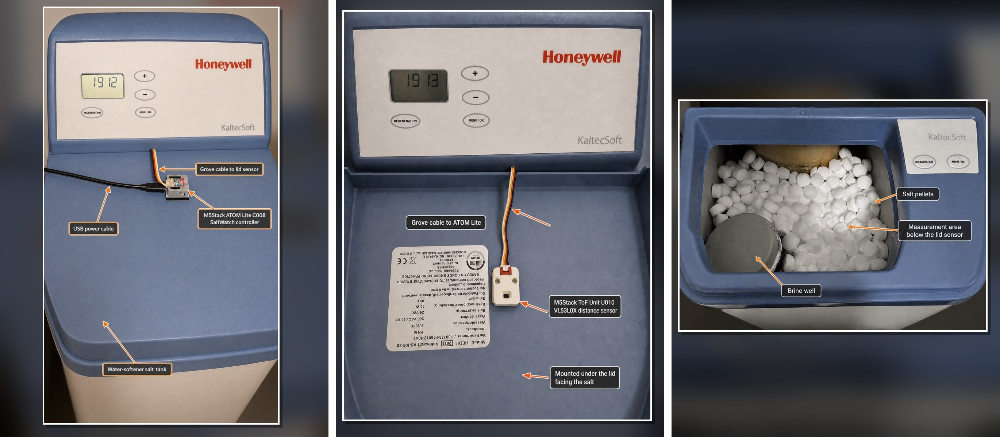
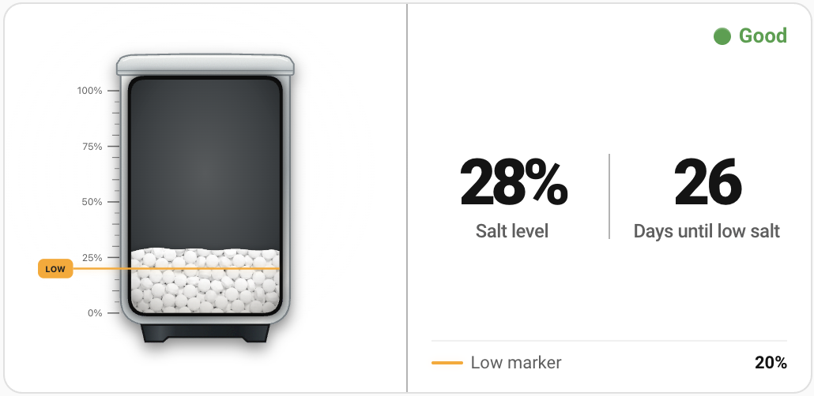
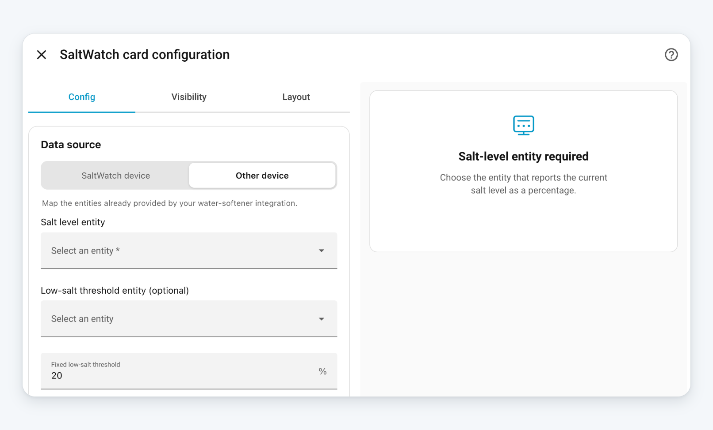

# SaltWatch Card

Visualize your water-softener salt level as a detailed tablet-filled tank, or
switch to a compact view of the current level, refill forecast, and health
status. SaltWatch Card follows your active Home Assistant light, dark, or custom
theme and adapts to desktop and mobile dashboards.

## The SaltWatch installation

The distance sensor sits beneath the tank lid, while the controller and power
cable remain outside. This example routes the thin Grove cable through the
existing hinge clearance, so no hole needs to be drilled.

Select the gallery to enlarge it.

## Choose the view that fits your dashboard

### Tank only

A focused visual gauge with the percentage scale and configurable low marker.

### Details only

Current salt level, estimated days until low salt, and device health in one
compact card. While the forecast is still learning or temporarily blocked, the
card shows a concise reason or progress such as `4 of 7 days collected`.

## Configure visually

  

Choose **SaltWatch device** for automatic, rename-safe discovery through Home
Assistant's device registry. Renaming entities or installing a second
SaltWatch does not create ambiguous pairings. Choose **Other device** to use an
existing water-softener integration by mapping its salt-level entity and, when
available, threshold, status, and forecast entities.

Layout, value, and visibility choices stay easy to find for either data source,
while tap, hold, and double-tap behavior has its own **Actions** section.

Automatic discovery requires the latest official SaltWatch firmware. Missing,
duplicate, or disabled card entities are reported explicitly rather than
guessed from entity names. Other devices need only a numeric salt-level entity;
all other mappings are optional.

## Open the device web interface

Turn on **Web interface → Enable shortcut** in the card editor. Click the
tank in tank-only view or use the external-link icon in details-only view.
The complete card offers both. Use the detected SaltWatch address or enter
a full URL for any mapped device.

The shortcut opens in your own browser by default. With **Chromium Link
0.2.0 or later** configured and available to your administrator account, choose
**Open with → Chromium Link** to open the device through Home Assistant while
away. This requires the **Mincka Chromium app**. [Chromium Link setup](https://github.com/thomasgregg/chromium-link#installation) · [Chromium app](https://github.com/Mincka/ha-addons/tree/main/chromium)

## Responsive dashboard sizing

The card uses automatic height by default. In a Sections dashboard, the Layout
editor keeps each view at a readable minimum:

| Selected content | Minimum grid size |
| --- | --- |
| Complete card (tank and details) | 6 columns × 4 rows |
| Tank only | 3 columns × 3 rows |
| Details with one value | 3 columns × 2 rows |
| Details with level and forecast | 6 columns × 2 rows |

Changing the selected content or displayed values updates these resizing
limits automatically, preventing clipped or overlapping layouts.

[Installation and card options](https://github.com/thomasgregg/saltwatch-card#installation) · [Web interface shortcut guide](https://github.com/thomasgregg/saltwatch-card#web-interface-shortcut)
